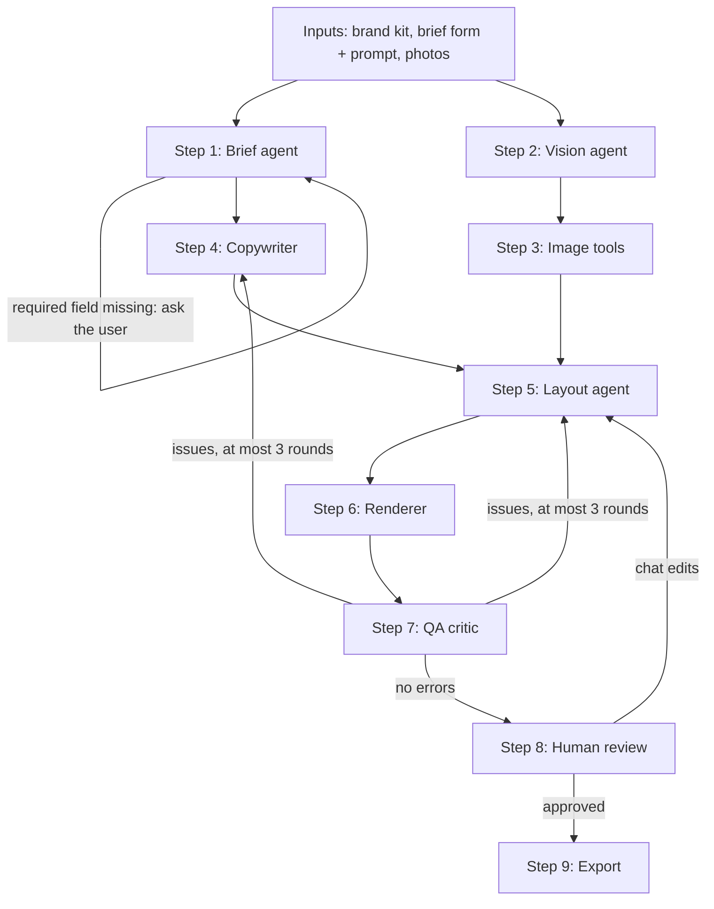

# Real estate brochure generator

## 1. What this is

An agentic system that turns a project brief, a prompt and a folder of photos into a print-ready brochure PDF for a
real estate company in India. Agents fill pre-built HTML/CSS templates; they do not design pages from scratch. A human
reviews and approves the result before it is exported.

Scope of v1, as far as the repo defines it today:

- One template, `classic-8pp`: 8 pages, A4 portrait, 3 mm bleed, 300 DPI target.
- No pricing page. Pricing is left out of the template on purpose.
- A4 is the only page size in the print config.

Most of the system is not built yet. Section 2 says what exists and what does not.

## 2. Status

Built (see [docs/CHANGELOG.md](docs/CHANGELOG.md) for the history):

- Contracts: Pydantic models for everything the pipeline passes around, plus exported JSON Schemas (section 6).
- Print rules: print config and DPI maths (section 7).
- Slots format, loader and the `classic-8pp` template (section 8).
- LLM interface with a `FakeLLM` for tests (section 9). There is no real LLM client.
- The pipeline graph (LangGraph) running on stub agents, with pause and resume for missing fields and for human review (section 3). The stubs return fixed sample data and make no LLM calls.
- A fictional sample project, "Aurelia Heights" (section 10).
- `brochure doctor`: checks Python, WeasyPrint, Ghostscript and bundled fonts. It is the only CLI command.
- CI on GitHub Actions: runs the unit tests on pushes to `feature/**` and `fix/**` and on pull requests into `master`.

Not built:

- Real agents. Vision, Copywriter, Layout and the QA critic are stubs. The brief step converts the form to facts and ignores the prompt; it does not use an LLM.
- The image tools. They are not in the graph yet.
- The renderer (HTML to PDF, bleed, crop marks, CMYK). The stub returns fake file paths and creates no files.
- Export. The stub does nothing.
- An API and a frontend.
- Checks of text length against `char_budget` and of images against the DPI rule inside a pipeline. The maths exists; nothing runs it yet.

## 3. How it will work

This is the design the contracts were written for. The graph that connects the steps is built and runs on stub agents (see "The graph on stub agents" below). The real agents, the image tools and the renderer are not built, and step 3 is not in the graph yet.



| Step | What it does | Today |
|---|---|---|
| 1. Brief agent | Turns the form and the prompt into `ProjectFacts`. Lists required fields that are missing in `missing_fields` so the user can be asked. | Real code for form to facts and the question loop; no LLM, prompt unused. |
| 2. Vision agent | Runs in parallel with step 1. Describes each photo as an `ImageTag` (kind, subject, quality, focal point). | Stub: returns the 12 sample image tags. |
| 3. Image tools | Plain code, not an agent. For each image: crops it to its slot's aspect ratio around the focal point, fixes exposure, runs the DPI check, and upscales by at most 2x. Low-resolution images are flagged and limited to small slots. Planned, not built. | Not built, not in the graph. |
| 4. Copywriter | Writes the text for each text slot, within its `char_budget`. | Stub: sample text, within each `char_budget`. |
| 5. Layout agent | Chooses which image and text goes in which slot and produces the `BrochureSpec`. Also applies the human's chat edits. | Stub: places the sample images and text in every slot. |
| 6. Renderer | Fills the HTML/CSS template from the spec and produces the PDF and one PNG per page. | Stub: fake paths, no files. |
| 7. QA critic | Looks at the pages and the spec and returns `QAIssue`s. Each issue says who should fix it (`route_to`). The loop stops after 3 rounds. | Stub: no issues unless scripted. The routing and the 3-round limit are real. |
| 8. Human review | A person approves, or asks for changes in chat. | Real: pauses, resumes with `approved` or `changes_requested`. No chat text yet. |
| 9. Export | Writes the approved PDF. | Stub: does nothing. |

### The graph on stub agents

`src/brochure/pipeline/` holds the graph, built with LangGraph. `build_graph(agents, checkpointer, llm)` compiles it
over `PipelineState`. `agents` is an `Agents` dataclass with one callable per step; the graph never imports a concrete
agent, so a real agent replaces a stub by being passed in, with no change to the graph. Every agent has the shape
`(state, llm) -> output`. The stubs are in `pipeline/stubs.py`. They read `templates/classic-8pp/slots.json` and the
files in `sample/` (including `sample/stub_copy.json`), make no LLM calls and render nothing.

- Brief and vision start in parallel; the copywriter starts when both are done. If the brief has missing required
  fields, the run pauses at `ask_user` with `missing_fields` set. The caller resumes with the values, for example
  `Command(resume={"rera_number": "..."})`, and the brief step runs again.
- After the renderer, the QA step runs. An issue routed to `copywriter` sends the run back to the copywriter (then
  layout, render, QA); one routed to `layout` goes back to layout; one routed to `none` does not loop. After 3 QA
  passes the run moves on whatever the issues say. Issues that do not loop, and any left after the 3rd pass, are
  written to `spec.qa_warnings`.
- `human_review` pauses. The caller resumes with `"approved"` (the run goes to export and ends) or
  `"changes_requested"` (back through layout, render and QA to review; `qa_round` restarts at 0). Any other answer is
  asked again.
- Checkpointers are passed in: `memory_checkpointer()` for tests, `sqlite_checkpointer(path)` for runs that must
  survive a restart.

This was run from the repo root:

```python
import json

from langgraph.types import Command

from brochure.contracts.brand import BrandKit
from brochure.contracts.project import Brief
from brochure.contracts.state import PipelineState
from brochure.llm import FakeLLM
from brochure.pipeline import build_graph, memory_checkpointer, stub_agents

state = PipelineState(
    template_id="classic-8pp",
    brand_kit=BrandKit.model_validate(json.load(open("sample/brand_kit.json"))),
    brief=Brief.model_validate(json.load(open("sample/brief.json"))),
    image_dir="sample/images",
)
graph = build_graph(stub_agents(), memory_checkpointer(), FakeLLM({}))
config = {"configurable": {"thread_id": "demo"}}

graph.invoke(state, config)
print(graph.get_state(config).next)  # paused at the review step
graph.invoke(Command(resume="approved"), config)
print(graph.get_state(config).next)  # empty: the run has finished
```

```
('human_review',)
()
```

Run the pipeline tests. They use the in-memory checkpointer and a temporary SQLite file, and they fail if anything
opens a network connection or calls the `FakeLLM`:

```
~/.venvs/brochure/bin/python -m pytest tests/unit/test_pipeline_graph.py tests/unit/test_pipeline_stubs.py tests/unit/test_pipeline_brief.py
```

## 4. Repository layout

```
.github/workflows/tests.yml   CI: unit tests on branch pushes and pull requests
contracts/json/               JSON Schema for each exported model (generated, committed)
docs/CHANGELOG.md             history, newest entry first
sample/                       fictional "Aurelia Heights" project (brand kit, brief, image manifest, image tags, logo)
src/brochure/
  cli.py                      `brochure` command (only `doctor`)
  doctor.py                   environment checks and fix hints
  print_config.py             A4 size, bleed, DPI thresholds
  dpi.py                      min_pixels, effective_dpi, classify_dpi
  slots.py                    load slots.json, compute min_px
  contracts/                  Pydantic models and the schema export
  llm/                        LLMClient, FakeLLM, Agent protocol
  pipeline/                   LangGraph graph, stub agents, checkpointers
templates/classic-8pp/        slots.json for the 8-page template (no HTML/CSS yet)
tests/unit/                   fast tests, no network
tests/integration/            tests that need WeasyPrint or Ghostscript
tools/                        export_schemas.py, make_sample_images.py
README.md                     this file
CONTRIBUTING.md               setup, TDD rules, branching rules
pyproject.toml                dependencies, pytest markers
```

## 5. Getting started

Setup is done in WSL (Ubuntu). The steps are in [CONTRIBUTING.md](CONTRIBUTING.md#setup-wsl-ubuntu). The examples below
use the virtualenv from that page, `~/.venvs/brochure`, and are run from the repo root.

Check the environment:

```
~/.venvs/brochure/bin/brochure doctor
```

The doctor prints one line per check and exits with 1 if any check fails. Python, WeasyPrint and Ghostscript are
checked for real. The bundled-fonts check currently fails because `assets/fonts` is not in the repo yet (see
section 13). Its "git restore" hint does not apply until the fonts are committed.

Run the tests:

```
~/.venvs/brochure/bin/python -m pytest                       # everything
~/.venvs/brochure/bin/python -m pytest -m "not integration"  # what CI runs
~/.venvs/brochure/bin/python -m pytest -rs                   # also print the reason for every skip
```

With Ghostscript and Pango installed, expect every test to pass and nothing to be skipped. Without them, the
integration tests skip with a stated reason. A skip is never meant to look like a pass.

Generate the sample images (they are git-ignored):

```
~/.venvs/brochure/bin/python tools/make_sample_images.py
```

This writes the 12 JPEGs listed in `sample/images.json` to `sample/images/`. The output is the same on every run.

## 6. The contracts

The models are in `src/brochure/contracts/`. All of them reject unknown fields, so a typo in JSON is an error. Field
names are plain snake_case and stable.

| Model | What it is | Produced by / used by (as designed) |
|---|---|---|
| `BrandKit` | Company name, logo, colours (hex, optional CMYK), fonts, about text, contact, disclaimer. | Provided by the user. Used by Copywriter, Layout, Renderer. |
| `BriefForm` | The form the user fills in: `ProjectFacts` with every field optional. | User. Read by the Brief agent. |
| `Brief` | `{form: BriefForm, prompt: str}`. | User. Pipeline input. |
| `ProjectFacts` | Validated facts: name, RERA number (required, non-empty), location, configurations, amenities, specifications, landmarks, possession, tone notes. | Brief agent. Used by Copywriter, Layout, QA critic. |
| `ImageTag` | What one photo shows: kind, subject, size, quality, features, focal point (fractions 0..1). | Vision agent. Used by image tools and Layout. |
| `Slot` / `SlotsFile` | One box on a page, and the file that lists them (section 8). | Written by hand per template. Read by the loader, then Layout, QA, Renderer. |
| `BrochureSpec` | The filled brochure: template id, pages (layout id and the content of each slot), QA warnings, version. Page count must be a positive multiple of 4. | Layout agent. Used by Renderer, QA critic. |
| `QAIssue` | A finding: check, page, severity, note, and `route_to` (copywriter, layout or none; required). | QA critic. Used by Copywriter, Layout and the human reviewer. |
| `ImageManifest` | List of image files with pixel size, kind and intended slot. | Only the sample project uses it. |
| `PipelineState` | What the graph carries: inputs, `project_facts`, `missing_fields`, `image_tags`, `slot_copy`, `spec`, `pdf_path`, `page_images`, `qa_issues`, `qa_round`, `approval_status`. | Every step reads and writes parts of it. |

JSON Schemas for these models (except `BriefForm`, which is nested inside `Brief`) are in
[contracts/json/](contracts/json/). The frontend generates its types from them. After changing a model, regenerate
and commit them in the same branch:

```
~/.venvs/brochure/bin/python tools/export_schemas.py
```

A test fails, and names this command, if the committed files are out of date. It compares parsed JSON, so line
endings do not matter.

## 7. Print rules

Defined in `src/brochure/print_config.py` and used everywhere; do not repeat the numbers elsewhere.

- A4 portrait, 210 x 297 mm.
- Bleed: 3 mm on every edge listed in a slot's `bleed_edges`.
- Target resolution: 300 DPI.
- Effective DPI = `min(img_w_px / slot_w_in, img_h_px / slot_h_in)`, where the slot size includes the bleed.
- Pass at 300 DPI or more. Warn from 250 up to, not including, 300. Fail below 250.
- `min_px = ceil(slot size in inches, bleed included, x 300)`.

Worked example from the sample project. This script was run from the repo root and printed the two lines below it:

```python
import json
from brochure.dpi import classify_dpi, effective_dpi
from brochure.slots import load_slots

template = load_slots("templates/classic-8pp/slots.json")
manifest = json.load(open("sample/images.json"))["images"]

for entry in manifest:
    if entry["filename"] in ("hero_tower.jpg", "amenity_clubhouse.jpg"):
        slot = template.get(entry["intended_slot"])
        dpi = effective_dpi(entry["width_px"], entry["height_px"], slot.bleed_width_mm, slot.bleed_height_mm)
        print(entry["filename"], f'{entry["width_px"]}x{entry["height_px"]} px',
              "->", slot.id, f"{slot.bleed_width_mm:g}x{slot.bleed_height_mm:g} mm",
              "min_px", slot.min_px, f"{dpi:.1f} DPI", classify_dpi(dpi).value)
```

```
hero_tower.jpg 2600x3650 px -> hero 216x303 mm min_px (2552, 3579) 305.7 DPI pass
amenity_clubhouse.jpg 1000x682 px -> amenity_img_b 88x60 mm min_px (1040, 709) 288.6 DPI warn
```

The hero slot is a full page (210 x 297 mm) bleeding on all four edges, so it is measured as 216 x 303 mm. The
clubhouse image has fewer pixels than the 1040 x 709 the slot needs, so it lands in the warn band.

## 8. Templates and slots

A template lives in `templates/<template_id>/`. For now it is only `slots.json`; the HTML and CSS do not exist yet.
Each slot has `id`, `type` (`image`, `text` or `qr`), `page`, `width_mm`, `height_mm`, `bleed_edges` (any of `top`,
`right`, `bottom`, `left`; empty when the slot is inside the trim), `char_budget` (text slots only) and an optional
`comment`. Sizes are the trim-side size; the loader adds the bleed from the config.

```json
{
  "id": "hero",
  "type": "image",
  "page": 1,
  "width_mm": 210,
  "height_mm": 297,
  "bleed_edges": ["top", "right", "bottom", "left"],
  "comment": "Full-page cover image, bleeds off all four edges."
}
```

`min_px` is never stored in the file. `load_slots` in `src/brochure/slots.py` computes it for image slots; a file that
contains `min_px` is rejected.

`classic-8pp` has 33 slots (14 image, 18 text, 1 QR):

| Page | Content | Slots |
|---|---|---|
| 1 | Cover | `hero` (full bleed), `cover_logo`, `cover_title`, `cover_tagline`, `cover_rera_line` |
| 2 | Overview | `overview_img` (bleeds top, left, right), `overview_headline`, `overview_intro`, `overview_highlights` |
| 3 | Location | `location_map`, `location_img`, `location_address`, `location_landmarks` |
| 4 | Amenities | `amenity_img_a`, `amenity_img_b`, `amenity_img_c`, `amenities_list`, `amenities_blurb` |
| 5 | Configurations and floor plans | `plan_img_a`, `plan_img_b`, `config_table`, `plan_note` |
| 6 | Specifications | `spec_banner` (bleeds top, left, right), `spec_img`, `specs_list` |
| 7 | About the developer | `about_img`, `about_headline`, `about_text` |
| 8 | Back cover | `back_logo`, `rera_number`, `rera_qr`, `contact_block`, `disclaimer` |

The QR slot `rera_qr` is 25 x 25 mm. That size is provisional: compliance has not given a minimum QR size for RERA,
and the slot's comment says so.

## 9. LLM interface and testing without a network

`src/brochure/llm/` has:

- `LLMClient`: a protocol with `complete(task, payload, images=None) -> dict`. `task` names the agent step, for
  example `"vision.tag"`. There is no real client yet.
- `FakeLLM`: returns canned responses keyed by task, records every call (`llm.calls`), and raises
  `MissingCannedResponse` naming the task when it has no answer.
- `Agent[I, O]`: a typing-only protocol. An agent is a function `(inputs, llm) -> schema object`. The stub agents are in
  `src/brochure/pipeline/stubs.py`; there are no real agents.

Unit tests never touch the network. Anything that would call a model uses `FakeLLM`. The `llm` pytest marker is
reserved for tests that call a real model and is not used by any test yet.

This example was run from the repo root:

```python
from brochure.contracts.images import ImageTag
from brochure.llm import Agent, FakeLLM, LLMClient, MissingCannedResponse


def tag_image(inputs: dict, llm: LLMClient) -> ImageTag:
    return ImageTag.model_validate(llm.complete("vision.tag", inputs))


llm = FakeLLM({"vision.tag": {
    "path": "pool.jpg", "kind": "render", "subject": "Infinity pool", "width_px": 2200, "height_px": 1150,
    "quality": "good", "features": ["pool"], "focal_point": {"x": 0.5, "y": 0.5},
}})
agent: Agent[dict, ImageTag] = tag_image
tag = agent({"path": "pool.jpg"}, llm)
print(tag.subject, [(c.task, c.payload) for c in llm.calls])

try:
    llm.complete("copy.write", {})
except MissingCannedResponse as error:
    print(error)
```

```
Infinity pool [('vision.tag', {'path': 'pool.jpg'})]
FakeLLM has no canned response for task 'copy.write' (it has: vision.tag)
```

## 10. The sample project

"Aurelia Heights" is a fictional project by a fictional developer, Kestrel Urbanscapes, in Pune. Its RERA number is a
placeholder (`P99999000000 (SAMPLE)`).

| File | What it is |
|---|---|
| `sample/brand_kit.json` | A `BrandKit`. |
| `sample/brief.json` | A `Brief`. The form is complete, so it converts to `ProjectFacts` unchanged. |
| `sample/images.json` | An `ImageManifest` of 12 images with pixel sizes and the slot each is meant for. |
| `sample/logo.svg` | The logo the brand kit points to. |
| `sample/stub_copy.json` | Text for the eight copy slots that cannot be derived from the facts or the brand kit; used by the stub copywriter. |
| `sample/image_tags.json` | An `ImageTag` for each of the 12 images, for code that runs before the Vision agent exists. |
| `sample/images/` | Generated by `tools/make_sample_images.py`; not committed. |

For their intended slots, three images fail the DPI rule and one warns:

| Image | Slot | Effective DPI | Result |
|---|---|---|---|
| `amenity_gym.jpg` | `amenity_img_c` | 230.7 | fail |
| `floorplan_3bhk.jpg` | `plan_img_b` | 207.8 | fail |
| `developer_office.jpg` | `about_img` | 190.5 | fail |
| `amenity_clubhouse.jpg` | `amenity_img_b` | 288.6 | warn |

The other eight pass. Having bad images on purpose lets the QA and Layout code be tested against failures without
needing real photos. A test pins exactly which images fail and which warns.

## 11. How we work

Full rules are in [CONTRIBUTING.md](CONTRIBUTING.md).

- Test-driven: no production code without a failing test first; the red must fail on an assertion; commit after
  each green cycle.
- Code changes go on a `feature/<name>` or `fix/<name>` branch, cut from the latest `master`.
- Docs-only changes (README, CHANGELOG, CONTRIBUTING wording) may go straight to `master` after the tests pass.
- Merge with `git merge --no-ff` after merging `master` into the branch and running the full suite.
- A change to the shared contracts (`src/brochure/contracts/`, `contracts/json/`, `templates/*/slots.json`) needs
  review by the other developer before it merges.
- Each feature branch adds an entry at the top of `docs/CHANGELOG.md`.

## 12. Glossary

| Term | Meaning |
|---|---|
| Trim | The final size of the page after cutting: 210 x 297 mm for A4. |
| Bleed | Extra artwork (3 mm here) printed beyond the trim so no white edge shows after cutting. |
| Full-bleed | An element that runs to the edge of the page, so it extends into the bleed. |
| Crop marks | Small lines outside the page that show the printer where to cut. |
| DPI | Dots (pixels) per inch. How sharp an image is at its printed size. |
| CMYK | The four inks (cyan, magenta, yellow, black) a printer uses. Screens use RGB, so colours are converted for print. |
| RERA | The Real Estate (Regulation and Development) Act. Each project has a registration number that must appear on marketing material. |
| Carpet area | The usable floor area of a flat inside its walls, without the walls themselves. The unit is sq ft. |
| Slot | A fixed box on a template page that holds one image, one piece of text or a QR code. |
| Artist's impression | A rendered picture of the building, not a photograph. Brochures label these as illustrative. |

## 13. Known limitations and follow-ups

- Logo slots (`cover_logo`, `back_logo`) are image slots, so the DPI rule would apply to them. They need an exemption
  for vector (SVG) logos.
- Apart from the full-page hero, the slot sizes are placeholders.
- The 25 mm QR size is provisional.
- `PipelineState` has no field for the text of a chat edit, so `changes_requested` re-runs layout with no instructions.
- The stub pipeline is hard-wired to `classic-8pp` and the sample files. The brief step ignores the prompt.
- A bad answer to the missing-fields question (a value that fails validation) raises an error instead of asking again. A bad review answer is asked again.
- The image tools are not in the graph.
- `brochure doctor` fails the fonts check because `assets/fonts` (Playfair Display, Inter) is not in the repo.
- `jinja2`, `qrcode` and `pypdf` are declared in `pyproject.toml` but nothing in the code uses them yet. WeasyPrint
  is only used by the doctor.
- Integration tests only check that WeasyPrint imports and that Ghostscript runs.
